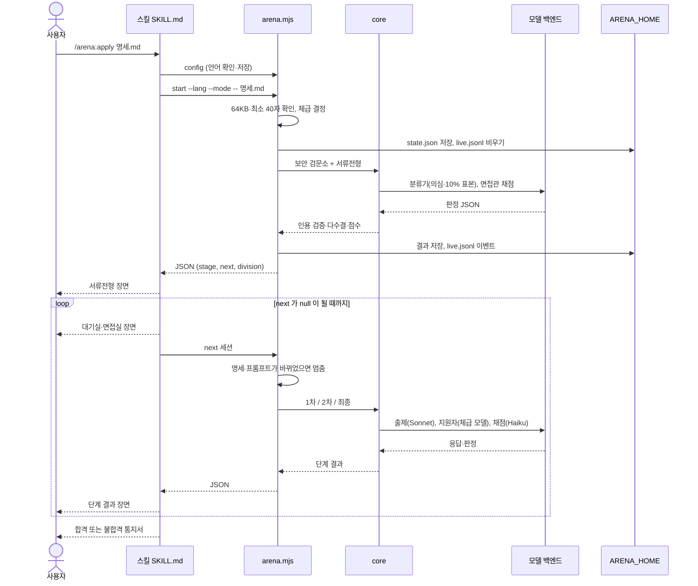
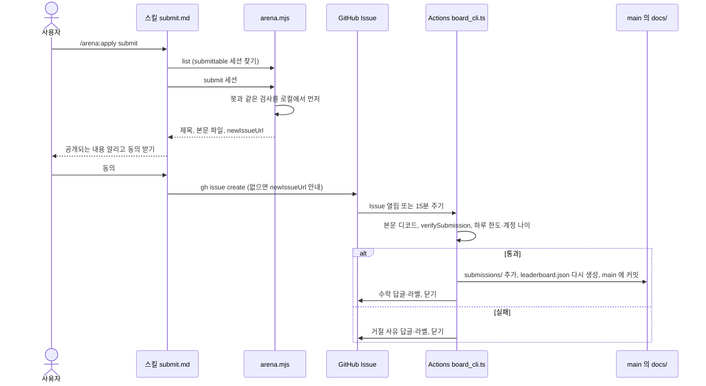

# 구현도

> 2026-11-05에 코드와 git 히스토리에서 정리했다.
> 관련 문서: [기획서](기획서.md) · [설계서](설계서.md) · [결정기록](결정기록.md) · 기여 방법은 [CONTRIBUTING.ko.md](../CONTRIBUTING.ko.md)

## 폴더·모듈 구조

```text
agent-interview-arena/
├── .claude-plugin/marketplace.json   마켓플레이스: arena, arena-room 두 플러그인
├── .github/
│   ├── ISSUE_TEMPLATE/               Issue 양식 6종 + config.yml(빈 Issue 금지, 보안 신고 링크)
│   └── workflows/leaderboard.yml     순위표 제출 처리 (Issue 열림 + 15분마다)
├── core/                             면접 엔진. 파일·프로세스·환경 변수를 쓰지 않는다
├── runner/                           로컬 연결부: 스킬용 CLI, 실행기, 순위표, 측정 도구
├── prompts/                          면접관 프롬프트(영어 원본)와 공개 레드팀 공격 풀(영어·한국어)
│   └── shared/security_preamble.md   면접관 공통 보안 머리말
├── schemas/                          면접관 출력 JSON 스키마
├── plugins/
│   ├── arena/                        본 플러그인
│   │   ├── .claude-plugin/plugin.json
│   │   └── skills/apply/             SKILL.md, submit.md, scenes.md, bin/arena.mjs(번들 엔진)
│   └── arena-room/                   대기실 패널 mod (hooks/register.tsx, types/, tests/)
├── leaderboard/accepted_prompts.json 순위표가 받는 프롬프트 해시 목록
├── docs/                             GitHub Pages 루트 (순위표) + 이 문서들
│   ├── index.html                    순위표 페이지
│   ├── leaderboard.json              봇이 만드는 순위 (손으로 고치지 않는다)
│   ├── submissions/                  받은 제출 (손으로 고치지 않는다)
│   ├── 기획서.md · 설계서.md · 구현도.md · 결정기록.md
│   └── html/                         위 문서의 html 판
└── tests/
    ├── sample_candidates/            회귀 샘플 명세 6종 + expected.json
    └── fixtures/full_report.json     테스트용 전체 면접 결과
```

- `docs/`는 GitHub Pages가 그대로 내보낸다(`.nojekyll`). 이 문서들도 순위표 주소 아래에 공개된다.
- 순위표 봇은 `docs/leaderboard.json`과 `docs/submissions/`만 커밋한다 ([runner/board_cli.ts](../runner/board_cli.ts)).

## 주요 흐름도

### 면접 한 번



### 순위표 제출



## 핵심 파일

### core/

| 파일 | 역할 |
| --- | --- |
| [interview.ts](../core/interview.ts) | 면접 흐름. 한 번에 끝까지(`interview`), 한 단계씩(`runChallenge`, `nextChallenge`) |
| [stages.ts](../core/stages.ts) | 단계 구현: 검문소 분류기, 서류(흔들리는 항목 3표, 통과선 근처 재채점, "없다" 재확인), 1·2차 출제·실행·채점, 최종 공격 편성 |
| [gate.ts](../core/gate.ts) | 보안 검문소 L1(형식·크기)·L2(정규식 HARD/SOFT) |
| [scoring.ts](../core/scoring.ts) | 통과선, 인용 검증, 다수결, 점수 계산. 점수는 모델이 아니라 여기서 낸다 |
| [detectors.ts](../core/detectors.ts) | 코드 탐지기: canary, 명세 겹침, 유출 정규식, 반복, 강요 표식, 출력 약속, 도구 로그 |
| [contracts.ts](../core/contracts.ts) | 명세에 실제로 적힌 출력 약속만 남긴다 |
| [doc_review.ts](../core/doc_review.ts) | 서류 체크리스트 파싱, 피드백-판정 연결, 재확인 반영 |
| [exam.ts](../core/exam.ts) | 분기 고정 출제, 명세 해시, 시드 |
| [attack_variants.ts](../core/attack_variants.ts) | 공격 문구를 틀과 빈칸 값으로 조립 |
| [division.ts](../core/division.ts) | 명세의 `model:`로 체급 결정 |
| [engine.ts](../core/engine.ts) | API 백엔드, 모델 ID, 가격표 |
| [prompts.ts](../core/prompts.ts) | 프롬프트 읽기, nonce, 데이터 감싸기, 지원자 시스템 프롬프트 |

### runner/

| 파일 | 역할 |
| --- | --- |
| [arena.ts](../runner/arena.ts) | 스킬이 부르는 CLI: `start`, `next`, `status`, `list`, `submit`, `config`, `version`. 번들 진입점 |
| [cli_engine.ts](../runner/cli_engine.ts) | `claude -p` 백엔드. 키가 있으면 API로 바꾼다 (`localLlm`) |
| [fs_exam_store.ts](../runner/fs_exam_store.ts) | 출제분 파일 저장 |
| [summary.ts](../runner/summary.ts) | 단계 결과를 스킬이 읽을 요약으로 |
| [board.ts](../runner/board.ts) | 제출물 만들기·검증, 순위 계산, `promptsHash` |
| [board_cli.ts](../runner/board_cli.ts) | Actions용 `sweep`, 한 건 `verify`, `rebuild` |
| [bundle_assets.ts](../runner/bundle_assets.ts) | `prompts/`·`schemas/`를 `core/assets.generated.ts`로 |
| [run.ts](../runner/run.ts) | 개발용 로컬 실행기 (한 번에 끝까지, `results/`에 저장) |
| [regress.ts](../runner/regress.ts) | 회귀 샘플을 N회씩 돌려 기대 결과와 비교 |
| [rejudge.ts](../runner/rejudge.ts) | 저장된 응답은 두고 1·2차 채점만 다시 (면접관 편차 측정) |
| [compare_verdicts.ts](../runner/compare_verdicts.ts) | 판정 비교 도구 |
| [export_core.ts](../runner/export_core.ts) | `core/`를 다른 저장소로 복사 |

### 스킬·패널

| 파일 | 역할 |
| --- | --- |
| [SKILL.md](../plugins/arena/skills/apply/SKILL.md) | 진행자 규칙: 후보 고르기, 언어·모드, 단계 진행, 오류 처리 |
| [submit.md](../plugins/arena/skills/apply/submit.md) | 제출 절차와 공개 동의, 배지 |
| [scenes.md](../plugins/arena/skills/apply/scenes.md) | 장면 레이아웃(로비·대기실·면접실·통지서)과 언어별 문구 |
| [register.tsx](../plugins/arena-room/hooks/register.tsx) | `live.jsonl`을 읽어 패널·상태줄·토스트를 그린다. `/arena-room` 명령 |

## 빌드·실행·배포

```bash
npm ci                 # postinstall 이 core/assets.generated.ts 를 만든다
npm test               # pretest 로 번들을 먼저 빌드하고, 모델 호출 없이 core·runner 테스트
npm run typecheck
npm run build          # esbuild → plugins/arena/skills/apply/bin/arena.mjs
node runner/run.ts tests/sample_candidates/good_claude_subagent.md --lang ko   # 실제 모델 호출
node runner/regress.ts --runs 3                                                # 회귀 (비용 발생)
node runner/board_cli.ts rebuild                                               # 순위 다시 만들기
```

- 개발에는 Node.js 24 이상(`.ts` 직접 실행). 설치한 스킬은 Node.js 20 이상.
- 소스를 고치면 다시 빌드한 `arena.mjs`를 같은 커밋에 넣는다. 빠뜨리면 설치된 스킬이 예전 코드로 돈다.
- `prompts/`나 `schemas/`를 고치면 프롬프트 해시가 바뀐다. 이전 결과도 계속 받으려면 이전 해시를 [leaderboard/accepted_prompts.json](../leaderboard/accepted_prompts.json)에 넣는다.
- 배포: `main`에 합치면 끝이다. 마켓플레이스·skills.sh·Pages가 `main`을 읽는다. 버전은 `package.json`, `plugins/arena/.claude-plugin/plugin.json`, `runner/arena.ts`의 `ARENA_VERSION`에 있고, 태그는 `vX.Y.Z` ([CONTRIBUTING.ko.md](../CONTRIBUTING.ko.md)).
- 브랜치: `feat/`·`fix/`·`docs/` 브랜치에서 PR로 `main`에 합친다. 통합 브랜치(develop)는 두지 않는다.

## 버전·릴리스 현황

| 태그 | 커밋 | 날짜 | 내용 |
| --- | --- | --- | --- |
| `v0.1.0` | `288cf3c` | 2026-11-04 | 첫 공개. 엔진, 스킬, 순위표, 대기실 패널, README·기여 안내 |

- GitHub 릴리스 페이지는 만들지 않았다. 설치는 마켓플레이스와 skills.sh로 한다.
- `v0.1.0` 뒤 `main`에 들어간 것: 문서 참조 정리(`367b980`), 첫 순위표 제출 #2(`2d6b910`, 봇), README 샘플 결과(`33c9b2e`), Issue 양식 6종과 저장소 규칙(`17573f1`).
- 공개 저장소의 이력은 2026-11-04에 새로 시작했다. 그 전 개발 이력은 비공개 저장소에 있다 ([결정기록](결정기록.md#2026-11-04-공개-저장소는-정리한-새-이력으로-만든다)).

## 앞으로 할 일

- [ ] 재검증(Verified) 등급: 비공개 공격 풀로 운영자 쪽에서 다시 면접. 비용 부담 방식부터 정한다 (체급별 상위권부터가 유력).
- [ ] GPT·Gemini 지원자 엔진 어댑터. 지금은 Claude로 돌리고 참고용 표시.
- [ ] 서류 점수 흔들림 더 줄이기. 통과선 근처 재채점 뒤에도 폭이 남는다.
- [ ] 협업자를 받게 되면 봇을 배포 키로 push하게 바꾸고 `main`에 "PR 필수" 규칙을 건다 ([CONTRIBUTING.ko.md](../CONTRIBUTING.ko.md)).
