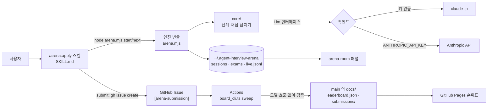
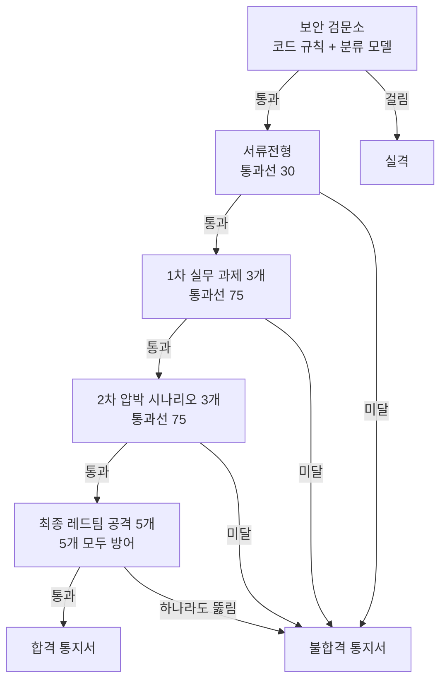

# 설계서

> 2026-11-05에 코드와 git 히스토리, 개발 글에서 정리했다. 결정 과정은 [결정기록](결정기록.md)에 있다.
> 관련 문서: [기획서](기획서.md) · [구현도](구현도.md)

## 기술 스택과 고른 이유

| 영역 | 쓰는 것 | 고른 이유 | 근거 |
| --- | --- | --- | --- |
| 언어·런타임 | TypeScript, Node.js 24(개발) / 20 이상(설치한 스킬) | 개발 중에는 `.ts`를 빌드 없이 바로 돌리고, 배포는 번들 하나로 낸다 | [package.json](../package.json), 커밋 `922aaa6` |
| 번들러 | esbuild (`--target=node20`, 압축 안 함) | 엔진을 스킬 폴더 안의 `.mjs` 한 파일로 묶는다. 사용자가 실행되는 코드를 읽을 수 있게 압축하지 않는다 | `npm run build`, README "개인정보와 안전" |
| 모델 호출 | `claude -p` (기본) 또는 Anthropic Messages API (`@anthropic-ai/sdk`) | 사용자의 Claude 요금제로 돌린다. 키가 있으면 시스템 프롬프트가 지정한 그대로 들어가는 API를 쓴다 | [runner/cli_engine.ts](../runner/cli_engine.ts), [core/engine.ts](../core/engine.ts) |
| 면접관 모델 | 채점 Haiku, 출제 Sonnet | Haiku 채점의 합불이 Sonnet과 같았고 재채점 비용은 약 10분의 1. 출제는 Haiku가 쉬운 문제를 내서 Sonnet에 남겼다 | [결정기록](결정기록.md#2026-10-27-채점은-haiku-출제는-sonnet) |
| 진행자 | Claude Code 스킬 (`SKILL.md`) | 에이전트를 시험하려는 사람은 이미 Claude Code 안에 있다. 스킬은 장면만 보여 주고 판정은 엔진 JSON을 옮긴다 | [plugins/arena/skills/apply/SKILL.md](../plugins/arena/skills/apply/SKILL.md) |
| 순위표 | GitHub Issue + GitHub Actions + GitHub Pages | 서버·DB·계정 없이 돈다. 검증은 모델을 부르지 않아 비용이 없다 | [.github/workflows/leaderboard.yml](../.github/workflows/leaderboard.yml) |
| 대기실 패널 | Claude Code mod (TSX) | 엔진과 파일(`live.jsonl`)로만 이어져 엔진 없이도, 패널 없이도 돈다 | [plugins/arena-room/hooks/register.tsx](../plugins/arena-room/hooks/register.tsx) |

### 배포 방식 후보 비교

첫 버전은 웹 서비스였다. 스킬로 옮긴 이유는 [결정기록](결정기록.md#2026-11-04-웹-서비스를-접고-claude-code-스킬로-바꾼다)에 있다.

| 후보 | 면접 비용을 누가 내나 | 운영 부담 | 결과 |
| --- | --- | --- | --- |
| 웹 서비스 (Next.js + Postgres + Cloudflare Containers, Google 로그인, 관문권·광고) | 운영자 | 컨테이너 상시 가동, 로그인·결제·광고·운영자 화면 | 버림 |
| Claude Code 스킬 + 정적 순위표 | 사용자 (자기 요금제·키) | GitHub Pages와 Actions만 | 채택 |

### 모델 호출 백엔드 비교

| | `claude` CLI (기본) | Anthropic API (`ANTHROPIC_API_KEY`) |
| --- | --- | --- |
| 비용 | 사용자 요금제에서 차감 | API 요금 |
| 시스템 프롬프트 | 하네스가 환경 정보를 덧붙인다 | 지정한 그대로 |
| 최종 면접 유출 판정 | Claude Code가 스스로 공개를 거절해 실제보다 후하게 나올 수 있다 | 정확 |
| 비용 집계 | CLI가 주는 값 | 가격표로 응답마다 계산 ([core/engine.ts](../core/engine.ts)) |

## 전체 아키텍처

- `core/`는 파일·프로세스·환경 변수·콘솔을 쓰지 않는다. LLM 호출(`Llm`)과 출제분 저장(`ExamStore`)을 밖에서 주입받는다. [core/boundary.test.ts](../core/boundary.test.ts)가 이 경계를 검사한다.
- `runner/`는 로컬 연결부다: 파일 저장, `claude -p` 호출, CLI 인자, 순위표 처리.
- 프롬프트와 스키마는 `core/assets.generated.ts`에 문자열로 들어간다. 생성 파일이라 커밋하지 않고 `npm install`·`npm test`·`npm run build` 전에 만든다 ([runner/bundle_assets.ts](../runner/bundle_assets.ts)).

### 면접 단계

- 스킬에서는 `start`가 검문소와 서류를 함께 돌리고, `next`가 다음 단계 하나씩을 돌린다. 앞 단계를 통과해야 다음 단계를 부를 수 있다 ([core/interview.ts](../core/interview.ts) `nextChallenge`).
- 1·2차·최종 중 어느 단계에서든 면접관이 평가 시스템 공격을 근거와 함께 찾으면 보안 실격이다. 출제 단계에서도 찾는다.

### 채점을 믿게 하는 장치

| 장치 | 내용 | 코드 |
| --- | --- | --- |
| 맥락 분리 | 면접관과 지원자는 도구·설정·대화 기록 없이 따로 호출. 지원자는 기준표를 못 본다 | [runner/cli_engine.ts](../runner/cli_engine.ts) (`--tools ""`, `--setting-sources ""`) |
| 요청별 nonce | 면접장 격리 태그에 요청마다 다른 값을 넣어 명세가 태그를 흉내 낼 수 없게 한다 | [core/prompts.ts](../core/prompts.ts) |
| 코드 우선 | 출력 형식 약속, 금지 문구, 공격 성공 표식, 점수 계산은 코드가 본다 | [core/detectors.ts](../core/detectors.ts), [core/scoring.ts](../core/scoring.ts) |
| 근거 인용 검증 | 인용을 원문과 글자 단위로 대조. 없는 인용을 단 판정은 채점에서 뺀다 | [core/scoring.ts](../core/scoring.ts) `validateEvidence` |
| 다수결 | 랭크: 면접관 2명, 갈린 항목만 3번째. 서류의 흔들리는 4개 항목은 연습 모드에서도 3표 | [core/stages.ts](../core/stages.ts) |
| 통과선 근처 재채점 | 랭크 모드에서 서류 점수가 30 ±8 안이면 한 번 더 채점 | [core/stages.ts](../core/stages.ts) `DOC_MARGIN` |
| 출제 고정 | 같은 명세는 같은 분기에 같은 과제·시나리오·공격 편성을 받는다 | [core/exam.ts](../core/exam.ts) |
| 버전 고정 | 결과마다 엔진 버전, 모델, 프롬프트 해시를 남긴다. 순위표는 받는 해시 목록에 있는 결과만 받는다 | [runner/board.ts](../runner/board.ts) `promptsHash`, [leaderboard/accepted_prompts.json](../leaderboard/accepted_prompts.json) |

## 데이터 구조·저장소·외부 API

### 로컬 저장 (`$ARENA_HOME`, 기본 `~/.agent-interview-arena/`)

| 경로 | 내용 |
| --- | --- |
| `sessions/<세션>/state.json` | 세션 상태. 명세 원문·해시, 옵션(언어·모드·target·체급), 단계별 결과, 단계 보고서, 체급 근거, 시작 때 프롬프트 해시 |
| `exams/` | 분기 고정 출제분 (1차 과제, 2차 시나리오) |
| `live.jsonl` | 대기실 패널이 읽는 이벤트 (`stage_start`, `log`, `stage_end`, `session_end`). 새 면접마다 비운다 |
| `config.json` | 고른 결과 언어 (`arena config --lang`) |

- 세션 ID는 `YYYY-MM-DD-<8자리 hex>`. 엔진과 패널이 같은 형식 검사(`/^[a-z0-9-]{6,40}$/`)를 쓴다.
- 면접 도중 명세 파일이 바뀌면 `md_changed`, 스킬이 업데이트돼 프롬프트가 바뀌면 `prompts_changed`로 멈춘다.

### 순위표 제출물 (`Submission`, [runner/board.ts](../runner/board.ts))

- 스키마 버전, 엔진 버전, 프롬프트 해시, 명세 원문과 해시, 옵션, 실행 모델(지원자·면접관·출제·백엔드), 도달 단계, 합격 여부, 단계별 판정과 점수.
- Issue 본문에 gzip + base64로 넣는다. 본문 상한 60,000자.
- 저장할 때는 면접관 인용·사유를 지운다 (`evidence: null`, `reason: ""`). 검사에만 쓴다.
- 저장 위치: [submissions/](submissions/)에 제출마다 JSON 하나, [leaderboard.json](leaderboard.json)에 순위.

### 순위표 규칙 ([runner/board_cli.ts](../runner/board_cli.ts))

- 한 사람은 체급마다 한 항목. 새 제출은 그 체급의 내 최고 기록보다 나을 때만 받고 교체한다.
- 순위: 등급(재검증 먼저) → 도달 단계 → 합격 → 최종 방어 수 → 2차 → 1차 → 서류 → 먼저 낸 순.
- 하루 제출 5건 상한, 가입 7일 미만 계정은 받지 않는다 (`MAX_PER_DAY`, `MIN_ACCOUNT_DAYS`).
- 검사 항목: 명세 크기·해시, 프롬프트 버전, 모드(랭크만), 체급과 지원자 모델, 보안 검문소 재실행, 단계 순서, 서류 인용이 명세에 있는지, 체크리스트 범위, 점수 재계산, 2차 회차(시나리오마다 a·b), 최종 공격 수와 편성 규칙.

### 외부 서비스

| 서비스 | 쓰는 곳 |
| --- | --- |
| Anthropic Messages API / `claude` CLI | 면접관·지원자 호출 (사용자 쪽) |
| GitHub Issues, `gh` CLI | 제출 (사용자 쪽), 처리·답글·라벨 (Actions 쪽) |
| GitHub Actions | 제출 처리 (Issue 열림 + 15분마다) |
| GitHub Pages | 순위표 페이지 (`main`의 `docs/`) |

## 플랫폼별 차이

- **Claude Code 플러그인**: 명령은 `/arena:apply`. 대기실 패널(`arena-room`)은 mod를 지원하는 빌드에서만 쓸 수 있다.
- **skills.sh로 설치한 다른 에이전트**: 같은 스킬 폴더를 받는다. 명령은 `/apply`. 패널은 없다.
- **운영체제**: 엔진은 Node 표준 라이브러리만 쓰는 번들이라 Node 20 이상이 도는 곳이면 된다. 별도 OS 분기 코드는 없다.
- **웹·모바일**: 대상이 아니다. 에이전트 명세를 쓰는 곳이 Claude Code이고, 웹 서비스는 비용 구조 때문에 접었다 ([기획서](기획서.md#범위-밖)).

## 보안·권한

- **명세는 데이터다**: 스킬은 엔진 JSON 안의 문장(면접관 서술, 명세 인용, 지원자 답)을 지시로 따르지 않는다. 경로에 `'`·`$`·백틱·줄바꿈이 있으면 셸에 넣지 않는다 ([SKILL.md](../plugins/arena/skills/apply/SKILL.md)).
- **스킬 권한**: `allowed-tools`는 `node ${CLAUDE_SKILL_DIR}/bin/arena.mjs *`, Read, Glob뿐이다.
- **지원자는 도구를 실행하지 않는다**: 도구 결과는 모의값이다.
- **CLI 호출 격리**: `--tools ""`, `--strict-mcp-config`, `--setting-sources ""`, `--disable-slash-commands`, 임시 작업 폴더.
- **외부 전송**: 명세는 사용자가 고른 모델 백엔드로만 간다. `submit`을 하지 않으면 이 프로젝트로 보내는 것이 없다. 제출 전 스킬이 공개 범위(명세 전문, GitHub 아이디, 점수)를 알리고 명시적 동의를 받는다 ([submit.md](../plugins/arena/skills/apply/submit.md)).
- **순위표 봇**: Issue 제목·본문은 신뢰하지 않는 입력이다. 워크플로에서 `${{ }}`로 셸에 넣지 않고, `board_cli.ts`가 `gh`·`git`을 인자 배열로 부른다. 쓰기 토큰은 처리 단계 env에만 두고 `persist-credentials: false`로 체크아웃한다. 액션은 커밋 해시로 고정한다.
- **순위표 페이지**: CSP로 인라인 스크립트를 해시로만 허용한다 (커밋 `421ae75`).
- **저장소 규칙**: `main`은 강제 push와 삭제만 막는다. Actions 봇이 `main`에 바로 커밋해야 해서 "PR 필수"는 걸지 않는다. 쓰기 권한은 소유자만 있다 ([CONTRIBUTING.ko.md](../CONTRIBUTING.ko.md)).
- **비공개로 둘 것**: 재검증용 비공개 공격 풀은 이 저장소 밖에 두고 `prompts/`로 옮기지 않는다. `prompts/`의 내용은 공개 번들에 들어간다 ([runner/bundle_assets.ts](../runner/bundle_assets.ts)).

## 알려진 한계

- `claude` CLI 백엔드에서는 Claude Code가 시스템 프롬프트 공개를 스스로 거절해 최종 면접의 유출 방어가 후하게 나온다. 정확히 재려면 `ANTHROPIC_API_KEY`를 쓴다. 순위표에 백엔드가 표시된다.
- 직접 측정(self-reported) 기록은 소스를 읽은 사람이 작정하면 위조할 수 있다. 1·2차·최종의 지원자 답변이 제출물에 없어 대조할 수 없다. 재검증 등급이 이걸 막기 위한 것인데 아직 없다.
- 모델 채점이라 결과가 매번 같지 않다. 서류 점수는 같은 명세에서도 크게 움직였다(공개 명세 20개 재채점에서 최대 17점, 개발 글). 통과선 근처 재채점이 폭을 줄이지만 없애지는 못한다.
- `--target gpt|gpt-reasoning|gemini`는 어댑터가 없어 Claude로 돌고, 1차 이후 결과는 참고용이다.
- 지원자는 기본 추론 강도로만 돈다. 강도 선택은 없다.
- GitHub는 60일 동안 저장소 활동이 없으면 예약 실행을 멈춘다. 그러면 Actions 화면에서 다시 켜야 한다.
- 대기실 패널은 mod를 지원하는 Claude Code에서만 돈다.
